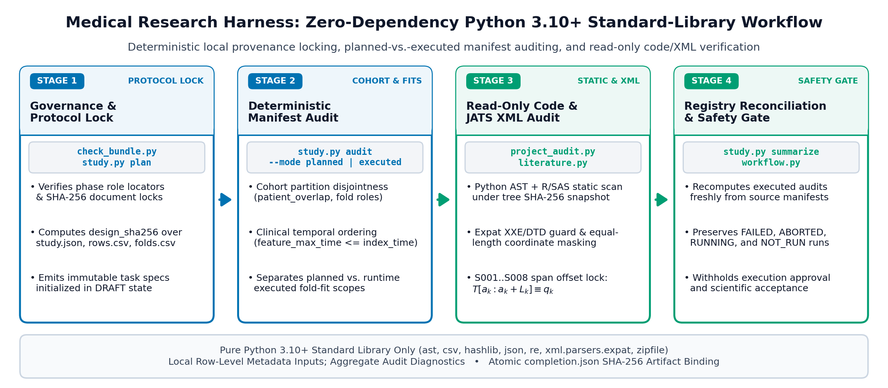

# Summary

Medical Research Harness is an open-source Python toolkit that helps researchers check whether a clinical prediction study followed its declared data and analysis boundaries. Prediction studies often contain repeated records from the same patient, measurements that become available at different times, and multiple modeling attempts. A reproducible assessment requires connecting these details to the study protocol and to what was actually executed. The harness checks these connections and produces evidence for human review. It does not train predictive models, provide clinical recommendations, or assign an automatic PROBAST risk-of-bias rating.

The deterministic core uses the Python standard library and can run from source or as an installed command-line package. A coding-agent skill supplies methodological guidance alongside the scripts. Private inputs remain in the research environment: the audit reads row-level metadata containing identifiers, split memberships, and timestamps, and exports aggregate diagnostics. These inputs are not aggregate data and must receive appropriate access controls. Raw feature tables, individual predictions, and clinical embeddings are not required by the manifest audit interface.

# Statement of Need

Systematic reviews document substantial risk of bias in clinical prediction research [@wynants2020covid; @andaur2021risk]. PROBAST and PROBAST+AI provide structured methodological assessment frameworks [@wolff2019probast; @moons2025probastai], while TRIPOD+AI addresses transparent reporting [@collins2024tripodai]. Applying these standards requires evidence about actual data handling, not just a completed checklist. Leakage can invalidate evaluation even when the chosen estimator is appropriate [@kapoor2023leakage].

The intended users are clinical modeling teams, statistical collaborators, and methodology reviewers who need inspectable evidence about patient separation, temporal availability, training-fold membership, and completeness of reported attempts. The toolkit connects a declared protocol to immutable input identities, distinguishes permitted fits from recorded fits, and reconciles successful, failed, interrupted, and unexecuted tasks. This narrows the gap between methodological intentions and reviewable implementation evidence. It cannot establish whether an exported log faithfully represents the originating computation; that remains a responsibility of the exporter and reviewer.

# State of the Field

PROBAST and related reporting standards define the assessment questions but do not themselves execute file-integrity or membership checks. RobotReviewer addresses automated risk-of-bias assessment in randomized trials [@marshall2016robotreviewer], whereas this toolkit focuses on clinical prediction workflows and evidence provenance.

General tools such as [MLflow](https://mlflow.org/), [DVC](https://dvc.org/), [Great Expectations](https://greatexpectations.io/), and [Deepchecks](https://www.deepchecks.com/) provide experiment tracking, versioning, or validation capabilities. The harness is designed to complement those systems. Its particular contract links clinical time anchors and patient-grouped partitions with separate planned and executed fit records. Rather than require one tracking platform, it accepts explicit CSV and JSON exports from existing workflows. A standalone implementation was chosen to keep the audit contract inspectable and portable across sites with different research infrastructure. This choice trades ecosystem integrations and scalable data processing for a small dependency surface; it is not evidence of superiority over those tools.

# Software Design

The workflow separates four responsibilities. First, protocol compilation binds task specifications to protocol, cohort, and fold file hashes. Generated tasks begin as drafts. Existing scientific approvals and an explicitly supplied external validator are required for preflight approval checks; compilation alone does not authorize execution.

Second, manifest auditing checks patient separation, temporal ordering, fold completeness, and fit membership. Planned records describe allowed operations before execution. Executed records must identify a particular experiment and run. Keeping these modes separate prevents a valid plan from being presented as evidence that the corresponding computation occurred. The current contract assumes patient-disjoint partitions and complete internal folds; other study designs require a reviewed adapter rather than an unannounced change to the scientific question.

Third, project inspection combines read-only code scanning with deterministic manifest checks. Python syntax trees and R/SAS text patterns provide risk indicators rather than proofs of semantic correctness. Target-tree snapshots detect changes, but do not replace an operating-system sandbox. A separate literature path indexes JATS XML and checks exact quoted spans. Its offline recovery checkpoints preserve verified artifacts after interruption; this does not establish recovery of interrupted model requests or the clinical correctness of extracted statements.

Fourth, registry reconciliation retains all registered attempts and identifies planned tasks with no recorded run. Executed audits are recomputed from referenced manifests rather than trusted solely because an earlier report says PASS. Workflow completion records bind output hashes. Outputs distinguish execution authorization from scientific validity: for example, study reconciliation reports that scientific validity has not been assessed, while workflow artifacts explicitly withhold scientific acceptance.

Hashing detects changes relative to recorded identities; it does not authenticate the person who approved a protocol. Similarly, exact citation matching establishes textual location rather than semantic validity. These boundaries are deliberate architectural choices that keep deterministic software checks separate from scientific judgment. Fault-injection tests exercise rejection paths without requiring clinical data or external models.

# Research Impact Statement

Existing use is developer-led and exploratory. A documented two-article public-literature pilot exercised indexing, model-assisted analysis, a separate review context, and quotation checks. The recorded run remained PARTIAL: six of eight questions lacked sufficient evidence, and the original model-response bytes were not retained. It is evidence of workflow use, not a validated clinical assessment or an evaluation of the current implementation. Subsequent offline repairs were tested separately and do not retroactively validate that run.

The repository also documents use of the manifest audit and reconciliation components in the MedBias-Laya research workflow. A retained local reconciliation report records successful structural checks, but a referenced project-audit artifact is missing and the full research chain has not been freshly verified. No model performance claim is made here. An accompanying [evidence register](RESEARCH_USE_EVIDENCE.md) separates these historical records from current synthetic regression results and lists the missing evidence. External adoption, clinical validity, and expert-level assessment accuracy have not been established. Before submission, the author must provide an editor-reviewable research-use package and determine whether this evidence meets the journal's impact requirement.

# AI Usage Disclosure

AI assistants were used for code refactoring, synthetic test authoring, code inspection, documentation, and manuscript editing. This revision used OpenAI Codex in ChatGPT; the exact served model version was not exposed in the session. Historical pilot records name `magpie/codex/gpt-6.1-sol` and `magpie/codex/gpt-6-astra` as analysis and review model identifiers; these are runtime experiment identifiers, not a complete inventory of development tools. The author must confirm the complete tool/version inventory and personally review, edit, and validate the assisted material and core design decisions before submission. This draft does not attest that this human review has already occurred. Deterministic audit commands make no LLM calls; optional explicitly enabled literature and advisory adapters may invoke models.

# Acknowledgements

The author acknowledges the methodological foundations provided by PROBAST, PROBAST+AI, and TRIPOD+AI. Funding, sponsor involvement, and conflicts of interest require author confirmation before submission.

# References
